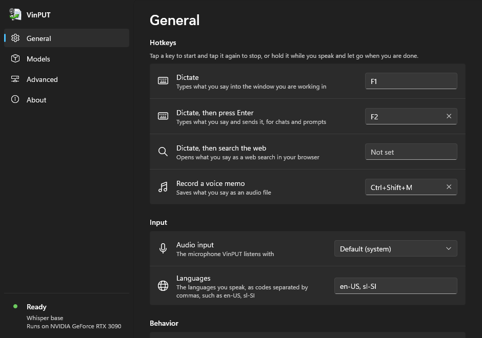
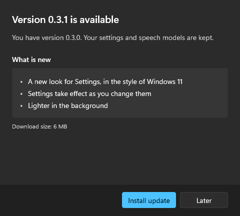

# Vinput

A lightweight Windows background app that types what you say into whatever text input has focus, searches the web for it, and records voice memos. The bar is a keyboard: instant, and it never fails silently.

## Using it

Vinput lives in the system tray. Two keys drive dictation, **F1** and **F2** by default:

- **Tap** the key to start dictating and tap again to stop, or **hold** it and release when you are done.
- **Escape** cancels. A dictation, search or memo that is running, or that has stopped and is still being recognized, is dropped: nothing more is typed, opened or saved. Escape is Vinput's only for that long; the rest of the time it does what it does everywhere.
- **F1** types what you said. **F2** does the same and then presses Enter, for chat boxes and prompts.
- While it listens, the tray icon turns red and a small live audio meter appears under the text cursor. A soft sound marks the moment it starts listening.

A key you pick in Settings does a **dictated search**: tap or hold it, say what you are looking for, and Vinput opens the search in your default browser, whatever window you were in. It searches with Google unless you put another address under Settings, Advanced, Web search, with `%s` where the words go: `https://duckduckgo.com/?q=%s`, `https://www.bing.com/search?q=%s`, or the search of any other site.

Another key you pick records a **voice memo**: tap or hold it, speak, and Vinput saves an MP3 to `Documents\Vinput memos` and puts the file on the clipboard, so Ctrl+V drops it straight into a messenger, a mail or a folder.



Click the tray icon to open Settings. Right-click it for what Vinput is doing, **Settings**, the **Model** and the **Audio input** in use, **Use the graphics card**, **Open voice memos**, **Check for updates**, **Start with Windows** and **Quit**.

Vinput listens with the microphone Windows uses by default. To use another one, pick it under Settings, General, **Audio input**, or from the tray menu; the list shows the microphones that are connected when it opens, and the choice applies to the next dictation without a restart. If the chosen microphone is unplugged, Vinput uses the default one until it is back.

Vinput takes its keys exclusively while it runs, so the focused app no longer sees them.

## Speech models

Vinput comes with no model chosen. The first start opens Settings on the Models page, and a hotkey pressed before a model is chosen shows a notification that leads there. Pick the model under Settings, Models:

| Model | Runs | Text arrives | Needs |
| --- | --- | --- | --- |
| Google Cloud Speech (Chirp 3) | Online | As you speak | A Google Cloud project |
| Google Gemini 3.5 Transcribe | Online | As you speak | A Gemini API key |
| NVIDIA Parakeet TDT v3 | On this PC | When you stop | A 677 MB download |
| Whisper large-v3 turbo | On this PC | When you stop | A 1.6 GB download |
| Whisper large-v3 turbo (compact) | On this PC | When you stop | A 582 MB download |
| Whisper base | On this PC | When you stop | A 156 MB download |

Each model in the list shows where it runs, its size and languages, and its state: Not downloaded, Downloading with its progress, Installed, In use or Failed. The buttons under the list do what the selected model calls for: **Download** (or **Cancel**, **Retry**), **Use**, **Remove**. The page also says how much disk space the downloads take. Vinput downloads the model and the engine that runs it (whisper.cpp) from their pinned release addresses, checks each file against a pinned SHA-256, and unpacks them under `%LOCALAPPDATA%\Vinput`. An interrupted download continues where it stopped. With a local model nothing you say leaves the PC.

The engine is a separate program that Vinput starts only while a local model is selected, and ends after ten minutes without a dictation, so the background app itself stays small. The same page names the graphics card of the PC and offers **Run local models on the graphics card**, which is ticked by default when there is one. A model is the same file either way: changing the switch keeps every downloaded model, fetches the engine for the other way in the background, and runs the model on the engine that is already here until it arrives. A model chosen with **Use**, like the switch, takes effect at once; the top right of Settings shows the model in use and whether it runs on the graphics card or the processor. That uses a Vulkan build of the engine (an 18 MB download), which runs on NVIDIA, AMD and Intel cards. The engine's own releases have no such build, so it is built from the same pinned release by `.github/workflows/engine-vulkan.yml` and served from the Vinput site, checked against its pinned SHA-256 like every other download. A PC that already has the NVIDIA (CUDA) build of an earlier version keeps using it.

**Add custom model...** under the list adds a Whisper model of your own, for example one fine-tuned for your language. Paste a Hugging Face link (a model page such as `https://huggingface.co/<org>/<model>`, a file in it, or just `<org>/<model>`) and press **Find**, or press **Browse...** to pick a file on this PC. For a model page the files that may be models are listed to pick from. Vinput runs Whisper models in the ggml format of whisper.cpp (`.bin`); before adding a file it reads its first bytes, and a file in another format (PyTorch, safetensors, GGUF) is refused with a one-line reason instead of failing later. An added model joins the list marked Custom, with the same states and buttons as the others, and runs on the processor or the graphics card like them. It is downloaded like the built-in models, resumable and pinned to the commit it was found at, and checked against the SHA-256 Hugging Face publishes for it; a file from this PC is copied in. Added models are kept in `%APPDATA%\Vinput\models.ini` and their files under `%LOCALAPPDATA%\Vinput\models\custom`; **Remove** deletes the file and takes the model off the list. Only public models can be added.

The two Google models run with a key or a project of your own; Vinput comes with neither. **Set up** on either of them opens a guided setup of four steps: which service, how to get what it needs from Google (with a button that opens the right Google page), entering it, and done. What you enter is checked with Google as you enter it, and the page says in a sentence what is wrong if it does not work: a wrong key, an API that is not switched on, a project without billing, no connection. Once set up, **Change** on the model opens the setup again with what is set.

- **Gemini**: paste an API key from [Google AI Studio](https://aistudio.google.com/apikey). It is kept in the Windows credential store, never in the settings file or the log.
- **Google Cloud**: the project ID, the region (the European Union unless you pick another), and credentials: the sign-in the [Google Cloud CLI](https://cloud.google.com/sdk/docs/install) leaves on the PC (`gcloud auth application-default login`), or a service account key file, of which Vinput keeps what it needs in the Windows credential store. The project needs billing and the Speech-to-Text API.

## Other programs

Vinput only types, searches and records. Everything else is built outside it, on its local API: a named pipe at `\\.\pipe\vinput` on which other programs see when Vinput listens, start and stop a session of any kind, receive a dictation's text instead of having it typed, and learn where each voice memo was saved. See [docs/api.md](docs/api.md). Settings, Advanced shows which programs are connected and can switch the API off.

Tools that only need to poll can read `%APPDATA%\Vinput\state`, which holds the single word `listening` or `idle`.

## Installing and updating

A release is one file, `VinputSetup-<version>.exe`. It is Vinput itself under another name: started that way it shows a setup window and, on **Install**, copies itself to `%LOCALAPPDATA%\Programs\Vinput`, adds the Start menu entry and the "Installed apps" entry, and starts. It needs no administrator rights.

Vinput looks for a newer version at start and every six hours (Settings, General, **Check for updates automatically**). The **Check for updates** button beside it looks at once and answers in place: up to date, or the version that can be installed. When there is one, a notification and the tray menu lead to the update window, which shows what is new; **Install update** downloads the new setup program, checks it against the SHA-256 in the release manifest and lets it replace the running program. Settings (`%APPDATA%\Vinput\settings.ini`), stored keys and downloaded models are outside the program folder and are never touched; a settings file from an older version keeps its values, and keys a version does not know are written back unchanged.



Uninstall from Windows Settings, Installed apps, where it is listed as VinPUT. It asks whether your settings, keys and models should go too. `vinput.exe --uninstall --quiet` removes the program without asking and keeps them. The setup program installs without a window as `VinputSetup-<version>.exe --install --quiet`: it shows nothing, a failure included, ends with exit code 0 when it worked, and does not start Vinput on a new install (the Start menu entry does); a Vinput that was running is started again.

The manual and the release notes are on the site: [documentation](https://vinput-dasvcr.web.app/docs), [release notes](https://vinput-dasvcr.web.app/changelog).

To cut a release, see [docs/release.md](docs/release.md).

## Building

```bash
cargo build --release
```

```bash
target\release\vinput.exe
```

This builds the `vinput` package, the one that ships. A release build registers itself to start at sign-in (switch it off in the tray menu). Debug builds never do. If Vinput is installed and running on the PC, do not start a build of your own without arguments: use the one-shot commands below.

## Developer commands

Everything cargo runs from the repository is a separate copy named `dev`: it keeps its settings, log and models in `%APPDATA%\Vinput-dev` and `%LOCALAPPDATA%\Vinput-dev`, away from an installed Vinput, and shows no notifications and plays no sounds. So the commands below use the model chosen and installed for that copy. See "A second copy beside the installed one" in [ARCHITECTURE.md](ARCHITECTURE.md) for how to point them at the installed one instead.

Recognize a 16 kHz mono WAV file with the selected model and print the transcripts with timings, with no microphone involved:

```bash
cargo run -- transcribe clip.wav
```

Encode a 16 kHz mono WAV as a voice memo would be:

```bash
cargo run -- encode clip.wav memo.mp3
```

Print the address a dictated search would open, without opening it:

```bash
cargo run -- search "weather in Ljubljana"
```

List the models with their install state, and install one from the command line:

```bash
cargo run -- models
```

```bash
cargo run -- install-model whisper-base
```

Add a Whisper model from Hugging Face or from a file, and install it:

```bash
cargo run -- add-model https://huggingface.co/ggerganov/whisper.cpp/blob/main/ggml-tiny.bin
```

Look at a window on its own, over canned data (`settings`, `models`, `add-model`, `advanced`, `about`, `update`):

```bash
cargo run -- ui update --mock update
```

Look at one of the new windows over canned data, with no engine behind it, or save a picture of it (windows and scenes are listed in [ARCHITECTURE.md](ARCHITECTURE.md)). The canned data is part of a build for development only; the executable that ships does not carry it:

```bash
cargo ui models --mock downloading
```

```bash
cargo ui models --mock downloading --picture models.png
```

Measure where the time of a dictation with VinPUT Pro goes, without a microphone, a key or a window: a WAV file is dictated at the pace of speech, twice in a row, and each moment from the key press on is printed. Needs an access token in `VINPUT_PRO_TOKEN`; `VINPUT_CLOUD_URL` names another server than the real one. A build for development only:

```bash
cargo run -- pro-timing speech.wav
```

Record three seconds from the default microphone and print the peak level:

```bash
cargo run -- mic
```

Type text into whatever window has focus three seconds after you run it:

```bash
cargo run -- type "Hello from Vinput, čšž 😀"
```

Render the fallback tray icons and the caret indicator to an image:

```bash
cargo run -p vinput-host --example preview -- preview.bmp
```

## Architecture

A Cargo workspace: the engine (`crates/vinput-core`), the resident background process (`crates/vinput-host`), the windows (`crates/vinput-ui`), the contract between those two (`crates/vinput-view`), a thin binary (`crates/vinput`). The windows run in a process of their own that exists only while one is open and talks to the background process in lines of JSON. [ARCHITECTURE.md](ARCHITECTURE.md) has the crate map, the process model, where to change what, and what has to stay compatible between versions.

Each pipeline stage is a trait, so the orchestration is platform-independent and tested with fakes, and the Windows code and the speech providers stay behind those traits.

```text
AudioSource -> Transcriber -> TextSink
(microphone)   (provider)     (focused window)
```

Design choices that serve speed and reliability:

- The speech provider is set up once, in the background at start, so a key press only opens a new stream. Offline or unconfigured, Vinput still starts and says why when a dictation needs the service.
- Hotkeys are registered with Windows rather than read through a keyboard hook, so Vinput cannot slow down or break normal typing. Key releases are polled only while a session runs; when idle there is no fast timer.
- Text is injected as one batch per transcript, so the user's own keystrokes cannot interleave with it.
- Nothing heavy stays in the background process: local models run in a separate process, MP3 encoding uses the encoder that is part of Windows and is loaded when a memo is saved, and the windows live in a process that ends when they close.
- The executable needs nothing but Windows and carries little that Windows already has: the C runtime is linked in, plain HTTPS requests (updates, downloads, sign-in) go through the client that is part of Windows, and the one TLS library in it serves the two speech streams.
- A session that fails reports why in a tray notification and in the log instead of going quiet. A download only appears under its final name after its checksum matched.

Known gaps: with the Google Cloud model text arrives a sentence at a time rather than word by word; local models deliver the whole dictation when you stop; apps that do not expose their caret get the indicator at the bottom of their window instead; typing into windows of elevated (administrator) apps is blocked by Windows; releases are not code-signed yet, so Windows SmartScreen warns on first run.

## Engineering standards

- Toolchain pinned in `rust-toolchain.toml`; edition 2024.
- Lints configured for the workspace in `Cargo.toml`: clippy `pedantic`, no `unwrap`/`expect`/`panic` in library code, `unsafe_code` denied by default and allowed only inside the modules that call Win32, public items documented.
- CI on Windows runs `cargo fmt --check`, `cargo clippy -D warnings` and `cargo test` for the whole workspace on every push, and builds the shipping executable, reports its size and fails when it is over its budget. `cargo lint` and `cargo size` run the same locally.
- Dependencies are checked against the RustSec advisory database when they change and once a week.
- The release profile is built for size (`opt-level = "s"`, fat LTO, a single codegen unit, `panic = "abort"`); only the cryptography stays at `opt-level = 3`.

Credentials stay out of the repo; `.gitignore` excludes `.env` and common credential file names.

## License

Vinput is free software under the [GNU General Public License, version 3](LICENSE). Contributions are welcome; see [CONTRIBUTING.md](CONTRIBUTING.md).
